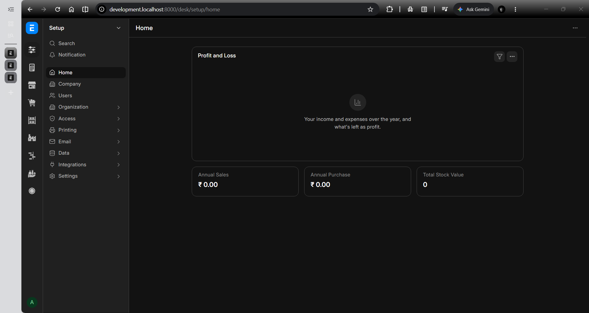
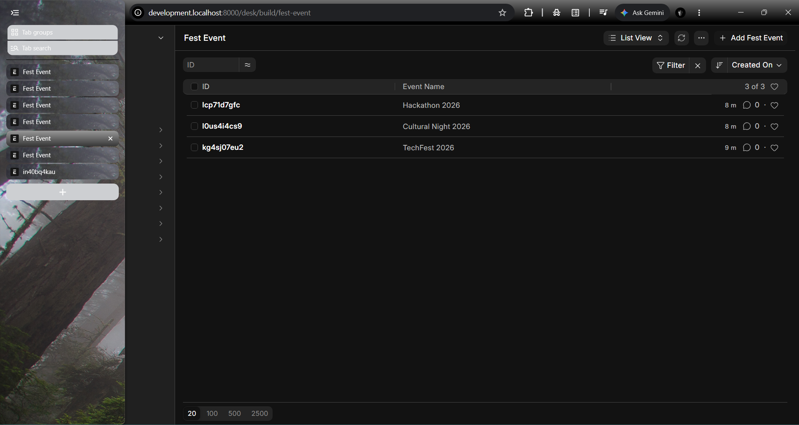

# ERPNext Warm-Up Assignment

A local development setup of the Frappe Framework and ERPNext, completed as part of the Spiders warm-up assignment. The task involved configuring a containerized development environment, installing ERPNext, creating a custom DocType, and adding sample records.

## Project Overview

The objective of this assignment was to set up Frappe and ERPNext locally, create a custom **Fest Event** DocType, and demonstrate its functionality by adding three event records.

## Technology Stack

- **Operating System:** Windows 11
- **Container Runtime:** Docker Desktop
- **Development Environment:** Visual Studio Code Dev Containers
- **Framework:** Frappe Framework `16.51.1`
- **ERP Application:** ERPNext `16.50.0`
- **Database:** MariaDB `11.8`
- **Caching and Queuing:** Redis
- **Git Repository:** GitHub

## Implementation

### 1. Development Environment Setup

- Installed Docker Desktop and verified the installation using the Docker CLI and the `hello-world` container.
- Cloned the official [frappe_docker](https://github.com/frappe/frappe_docker) repository.
- Configured the development container using the provided `.devcontainer` configuration.
- Opened the project in Visual Studio Code and connected to the Frappe Bench development container.
- Used Docker containers to isolate the development environment from the existing tools and software installed on the host machine.

### 2. Frappe and ERPNext Installation

- Inspected the provided installer and application configuration.
- Configured the installation to use the `version-16` branch for both Frappe and ERPNext.
- Initialized a Frappe Bench environment and created the `development.localhost` site.
- Configured MariaDB and Redis services for the development environment.
- Verified the installed applications using the Bench CLI.

### 3. Custom DocType: Fest Event

Created a custom DocType named `Fest Event` to manage college event information.

The DocType includes the following fields:

| Field Label | Field Type | Purpose |
|---|---|---|
| Event Name | Data | Stores the name of the event |
| Date | Date | Stores the event date |
| Venue | Data | Stores the event location |
| Capacity | Int | Stores the maximum number of attendees |

### 4. Sample Records

Added sample event records to demonstrate the custom DocType and its list view.

The records include:

- TechFest 2026
- Cultural Night 2026
- Hackathon 2026

## Screenshots

### ERPNext Home

Shows the ERPNext interface after completing the local setup and logging in.

### Fest Event List View

Shows the custom DocType and its event records in the list view.

## Challenges and Learnings

The most challenging part was the initial setup of Frappe and ERPNext inside Docker containers. I encountered difficulties starting the development containers, connecting Visual Studio Code to the correct container, and making the application accessible through the forwarded port. I troubleshot these issues by inspecting the Docker Compose configuration and container status, reviewing the installer, checking the Bench configuration, and examining server logs. This helped me understand how containerized development environments, database services, Redis, application processes, and port forwarding work together.

## What I Learned

- Setting up a containerized development environment using Docker Desktop and VS Code Dev Containers.
- Understanding the relationship between Frappe Bench, the Frappe Framework, and ERPNext.
- Using the Bench CLI to inspect applications, manage a site, and troubleshoot the development server.
- Configuring a custom DocType and creating records through the ERPNext interface.
- Documenting a development workflow and preparing a reproducible project submission.

## Repository Scope

This repository contains the assignment documentation and screenshots. The complete Frappe Docker source repository, database volumes, local site configuration, and other environment-specific files are intentionally excluded.

